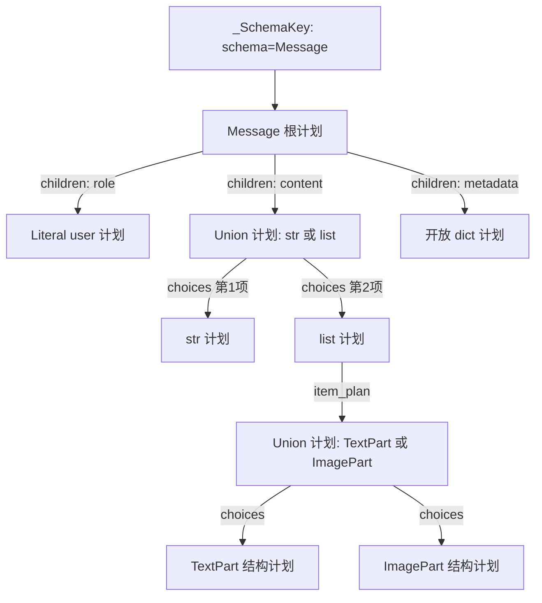

# Schema 过滤计划：缓存中保存的对象与运行过程

本文对应当前 [Schema 过滤实现](../../src/my_llm/codec/shared/transport.py)。
这里的“预编译”是把 SDK 的 Python 类型注解转换成可直接调用的 Python 函数图，
在首次使用该类型时生成，随后重复执行。

**缓存保存类型对象、字段规则、分支规则和处理函数；每次请求的值只作为函数参数传入。**
它不是“第一次请求的结构样本”，也不是 Encoder 到 Decoder 的转换结果表。

## 1. 先区分三种不同的 Schema / 数据

| 对象 | 例子 | 本文缓存如何处理 |
| --- | --- | --- |
| SDK 类型定义 | `ChatCompletionMessageParam`、`ResponseInputItemParam`、`MessageParam`、`Content`、`Tool` | 分析其 Python 类型结构，缓存处理计划。 |
| 用户工具的 JSON Schema | 工具 `parameters` 或 `input_schema` 中的 `properties`、`$defs`、`additionalProperties` | 按 SDK 字段声明作为应用字典处理，保留其内容；不为每份工具 JSON Schema 编译本计划。 |
| 本次请求值 | 用户文本、图片数据、工具参数、工具结果、消息里的扩展值 | 每次重新处理；不作为计划缓存的键或值。 |

例如 `Literal["user"]` 中的 `"user"` 是类型定义的固定判别常量，会随类型规则保留。
用户本次发送的 `"北京天气怎么样？"` 则是实际请求值，不会写入计划。

本文只讨论 Schema 过滤缓存。项目的其他状态各有用途：

| 位置 | 保存内容 | 生命周期 |
| --- | --- | --- |
| Schema 过滤缓存 | 类型、字段与处理函数 | 当前进程内复用。 |
| MyLLM 客户端缓存 | 官方 SDK 客户端 | 当前 MyLLM 实例。 |
| StreamState / BlockState 缓存 | 当前响应的物化块和终态消息，包含真实响应内容 | 当前请求。 |

因此，“Schema 缓存不保存实际请求值”不能理解为所有请求状态都不保存实际内容。

## 2. 模块中实际存在三份类型缓存

这些缓存都是 [transport.py](../../src/my_llm/codec/shared/transport.py) 中的模块级函数缓存，
由同一进程内的不同 MyLLM / Codec 实例共享。

| 缓存函数 | 键 | 返回并保留的值 |
| --- | --- | --- |
| `fields(schema)` | Python 类型定义 | 字段名到字段注解的字典。Pydantic 类型读取 `model_fields`；TypedDict 等类型读取 `get_type_hints`。 |
| `adapter(schema)` | Python 类型定义 | 对应的 Pydantic `TypeAdapter`，用于实际验证和序列化检查。 |
| `_compiled_plan(key)` | `_SchemaKey` 对象 | 根 `_FilterPlan` 对象，由它引用整个子计划图。 |

此次优化的主要新增部分是第三项。仅缓存字段名和 TypeAdapter，仍会让每个请求反复解析
嵌套注解、列表元素和 Union；完整计划把这些分析结果一起保存下来。

## 3. 缓存键具体保存什么

入口关系是：

```python
def _plan(schema):
    return _compiled_plan(_SchemaKey(schema))
```

`_SchemaKey` 实际只有三个槽位：

| 属性 | 保存的值 | 用途 |
| --- | --- | --- |
| `schema` | 原始 Python 类型对象或类型注解对象的引用 | 确定要编译的 SDK 类型。不是类型名字符串。 |
| `_hash` | 类型的哈希值；不可哈希注解使用对象身份值 | 支持缓存字典查找。 |
| `_hashable` | 布尔值 | 区分按类型比较和按对象身份比较的情况。 |

键不包含协议请求内容、消息字段集合、model 名称、ProviderProfile 或任何响应值。
同一类型可以处理许多字段形态不同的请求。

### 为什么没有直接使用 `@cache(schema)`

过滤器处理 Union 时，同分候选按声明顺序选择。Python 的 Union 相等比较可能忽略候选顺序：

```python
Left | Right
Right | Left
```

这两个注解需要在本计划缓存中区分，否则同分值可能复用错误顺序的计划。
`_SchemaKey.__eq__` 使用 `_same_schema` 递归比较泛型参数的实际顺序，
因此 `list[Left | Right]` 和 `list[Right | Left]` 也会分开。

等价的泛型注解仍可复用计划。`Annotated` 若携带不可哈希的 metadata，则按注解对象身份缓存。
该 metadata 属于类型声明，不是传入 `supported` / `projected` 的请求值。

## 4. 缓存值具体保存什么

真实的 `_FilterPlan` 没有 `fields`、`messages`、`output` 等属性，只有三个槽位：

```python
class _FilterPlan:
    __slots__ = ("apply", "project", "score")
```

每个槽位保存一个可调用对象。字段表、子计划和候选列表由这些函数的闭包引用。
闭包是函数随身保留的外部变量；本实现保留的是编译期间确定的类型规则。

| 槽位 | 调用形式 | 做什么 |
| --- | --- | --- |
| `apply` | `plan.apply(value)` | 过滤协议字段，为可变应用 payload 建立独立副本，内置不可变标量直接使用。 |
| `project` | `plan.project(value)` | 过滤协议字段，借用应用 payload，供只读验证。 |
| `score` | `plan.score(value)` | 根据当前值计算某个 Union 候选的匹配分数。 |

### 不同节点的闭包中有什么

| 类型节点 | 编译后保留的规则或引用 |
| --- | --- |
| TypedDict / Pydantic 结构 | `children`：字段名到子 `_FilterPlan` 的字典；评分函数另保留 `annotation`、`declared_keys` 和 `literal_fields`。 |
| 有元素类型的列表 | `item_plan`：元素类型的子计划。 |
| Union | `choices`：按声明顺序排列的候选计划元组；`apply` / `project` 通过 `select` 使用它。 |
| Literal | 声明中的常量参数，用于评分。 |
| 普通类型 | 判断所需的类型对象。 |
| 开放字典、Any 等应用 payload | `apply` 使用 `_copy_payload`；`project` 使用 `_borrow_payload`。 |

`value` 始终是上述函数的调用参数。函数执行结束后，不会把这个参数追加到计划中。
`children`、`choices` 等也不会因某次请求增加了字段而改变。

### 开放字典与协议结构的区别

处理方式取决于传入的类型声明，而不是运行时的值是否为 dict：

| 类型声明 | 当前值中未声明的字段 |
| --- | --- |
| `dict[str, Any]`、Any 等已识别开放应用数据 | 保留内部全部键值。 |
| TypedDict / Pydantic 协议结构 | 只保留声明字段；字段内部仍按各自类型处理。 |

SDK 模型的 extra 策略不提供未知协议字段的透传能力。项目只允许在已识别开放字典内部保留任意键，
不把模型的 `extra="allow"` 等同于协议翻译规则。非标准差异通过 Profile 明确支持的兼容能力处理。

缓存规则也不会读取首条请求中的额外字段名。新的已声明可选字段可在后续请求出现，开放应用字典
内部的新键随当前值处理；未知协议结构字段仍会过滤。完整边界见[翻译字段边界](translation-boundaries.md)。

协议结构的输入若为 SDK 的 Pydantic 对象，先按公开的 model_dump 接口取得结构，再执行同一类型计划；
不能通过模型实例绕过字典输入的字段规则。SDK 的标量序列化对象仍按其原生标量接口处理。

## 5. 用一个缩小类型把缓存展开

下面的类型用于说明算法和观察内存对象，实际生产过滤仍读取五家官方 SDK 类型。

```python
from typing import Any, Literal, NotRequired
from typing_extensions import TypedDict


class TextPart(TypedDict):
    type: Literal["text"]
    text: str


class ImagePart(TypedDict):
    type: Literal["image"]
    url: str


class Message(TypedDict):
    role: Literal["user"]
    content: str | list[TextPart | ImagePart]
    metadata: NotRequired[dict[str, Any]]
```

首次请求 `_plan(Message)` 后，缓存中有一项“Message 类型 → 根计划”。
根计划通过函数闭包引用下面这些节点：



下列是对真实对象的逻辑展开，便于阅读；它不是缓存实际保存的 JSON：

```text
cache entry:
  key:
    schema: Message 类型对象
    _hash: hash(Message)
    _hashable: True

  value: Message 的 _FilterPlan
    apply: structured_copy 函数
      closure.children:
        role     -> Literal["user"] 的计划
        content  -> str | list[TextPart | ImagePart] 的计划
        metadata -> dict[str, Any] 的计划

    project: structured_projection 函数
      closure.children: 同一份字段子计划字典

    score: structured_score 函数
      closure.annotation: Message 类型对象
      closure.declared_keys: role / content / metadata 的键视图
      closure.literal_fields: [("role", ("user",))]
```

可以看到，缓存中有 `"role"`、`"content"`、`"metadata"`、`"user"` 这些来自类型声明的规则，
但没有任何一条请求的完整字典，也没有某次过滤后的结果字典。

一条根缓存项会引用许多子节点。`cache_info().currsize` 统计的是根缓存项，
不是整张图的节点数。编译期间使用的局部 `plans` 字典按类型身份复用节点，
没有把每个子节点分别注册为全局根缓存项。

## 6. 两次不同结构的数据如何经过同一计划

第一次调用：

```python
first = {
    "role": "user",
    "content": "北京天气怎么样？",
    "metadata": {"request_id": "R1"},
    "vendor_extra": "本类型未声明的字段",
}
supported(first, Message)
```

运行顺序：

1. `_SchemaKey(Message)` 查找失败，开始编译上述完整计划，包括这次尚未使用的列表和图片分支。
2. 根计划遍历当前字典，保留 `role`、`content`、`metadata`，丢弃当前类型未声明的 `vendor_extra`。
3. `content` 的 Union 根据当前值选择 `str` 分支，返回本次文本。
4. `metadata` 是开放应用字典，`apply` 为它建立独立副本。
5. 返回本次结果；计划缓存仍只有类型规则。

第二次调用换成：

```python
second = {
    "role": "user",
    "content": [
        {"type": "text", "text": "上海天气怎么样？"},
        {"type": "image", "url": "https://example.invalid/map.png"},
    ],
    "metadata": {"request_id": "R2", "new_key": {"items": [1, 2]}},
}
supported(second, Message)
```

运行顺序：

1. 命中同一个 Message 根计划。
2. `content` 根据当前值选择列表分支；第一条请求选择过字符串分支，不影响本次选择。
3. 对列表中的每个元素重新评分：`type="text"` 选 TextPart，`type="image"` 选 ImagePart。
4. 开放 `metadata` 的 `request_id`、`new_key`、`items` 都保留；计划不记录这些键和值。
5. 返回第二条请求自己的结果。

缓存复用的是候选规则，实际分支选择和数据遍历每次仍执行。

### Union 运行时具体怎么选

以结构类型候选为例，评分规则是：

1. 检查当前值里已出现的 Literal 判别字段；与该候选声明不一致时，得分为 -1。
2. 其余候选按“当前字典与声明字段的交集大小 + 1”评分。
3. 取最高分；同分保留声明在前的候选。全部候选不适配时抛出 UnsupportedCapabilityError。

因此，计划没有保存“上一次选中了哪个候选”。也没有仅凭一个 `type` 字段把所有同类型名的
变体固定到同一分支。None、单候选等分支按当前实现直接处理，最终合法性仍由 TypeAdapter 验证。

## 7. apply 与 project 为什么共用计划却有不同复制行为

对于第二条数据的 `metadata`：

```text
plan.apply(second)
  -> 新的协议结构
  -> metadata 是独立副本

plan.project(second)
  -> 新的协议结构
  -> metadata 引用 second["metadata"]，只读借用
```

结构字段的筛选规则相同，区别在于应用 payload 是否需要独立修改。
`project` 的调用方必须只读使用借用值；当前调用方是输入验证路径。
测试覆盖了五家官方 SDK 的 `validate_python` 和 `dump_json` 不修改这些投影输入。

执行过滤后仍需要校验：字段缺失、字段类型、字面量及惰性 Iterable 的元素合法性不能只靠
过滤器的分支评分证明。TypeAdapter 仍逐次运行，`dump_json` 用来触发惰性元素验证。
缓存命中不会把这条请求直接判定为合法。

## 8. 在真实 generate 路径中的位置

以输入输出和上游都为 OpenAI Chat、且显式设置 stdio_protocol 为例：

| 顺序 | 本次运行的操作 | Schema 计划缓存参与情况 |
| --- | --- | --- |
| 1 | generate 只读规范化消息与工具。 | 不在这里查询计划。 |
| 2 | 输入 Transport 调用 projected，随后通过 TypeAdapter 验证。 | 首次遇到对应 SDK 类型时编译；后续复用。 |
| 3 | Encoder 编码当前消息与工具，生成本次中间态。 | 不跳过 Encoder。 |
| 4 | 校验生成选项，Decoder 构造当前原生请求。 | 不跳过 Decoder。 |
| 5 | 上游 Transport 调用 supported 过滤消息与工具，再验证。 | 同一 SDK 类型的计划可与步骤2复用；输入输出协议不同时分别使用对应类型计划。 |
| 6 | 官方 SDK 执行请求、解析返回事件。 | 仍执行 SDK 自己的处理。 |
| 7 | 每个事件经过 Encoder、StreamState、Decoder，再转换完整结果。 | 本计划缓存不替代返回路径，也不缓存响应结果。 |

第一次请求也可能在步骤2编译、步骤5就命中缓存；“冷请求”不代表它内部所有计划查询都未命中。

源码入口见 [generate](../../src/my_llm/invoke.py)、
[输入验证与请求边界](../../src/my_llm/codec/base/transport.py)和
[Codec 固定编排](../../src/my_llm/codec/base/codec.py)。

## 9. 生命周期、兼容变体与限制

### 进程内共享和内存代价

缓存使用 `functools.cache`，没有容量上限、TTL 或自动淘汰，退出进程后释放。
同一进程内已编译的规则由不同实例共享；不同进程各有自己的缓存。
内存增长取决于不同类型声明及其计划数量，而不是处理过多少条消息。

缓存强引用键与计划，计划又引用类型和子计划。因此，若运行中持续创建新的动态类型，
这些类型也可能随缓存保留。常规五协议使用稳定的 SDK 类型。

### 兼容服务的输入结构变化

- 可选字段增减、字符串与列表切换、不同合法内容块：按当前值执行已有计划。
- 开放应用字典中的任意业务键：按该字段声明整体处理，不按首条数据裁剪。
- SDK 未声明的新协议字段或新块类型：可能被过滤或拒绝，需要在协议所属 Transport / Codec 明确支持。
- 同一个类型对象在运行中被修改：当前没有自动失效机制，字段缓存、适配器缓存及计划缓存都需要重新建立。

此缓存不根据某次请求自动“学习”新字段。新增字段是否支持，仍由 SDK 类型、协议实现与
供应商配置约束共同决定。当前没有对外提供统一的动态失效接口；常规升级 SDK 或类型声明后，
通过重新启动进程建立相应类型规则。

### 并发与递归类型

编译时先把占位节点登记到局部表，再编译子字段，递归引用会指回同一个节点。
整个根计划编译完成后才从 `_compiled_plan` 返回并进入全局缓存。
过滤计划执行时只读类型规则，请求值保存在每次函数调用的局部变量中。

编译过程没有 await，同一事件循环中不会在编译中途切换请求。
`functools.cache` 保持多线程缓存表的一致性，但并发首次未命中时可能重复执行编译，
不保证所有线程合计只编译一次。这是 [Python cache 的既有语义](https://docs.python.org/3.12/library/functools.html#functools.cache)。

## 10. 可运行的小例子

在项目根目录执行下面的 Python 代码，可观察同一计划处理两份不同数据。
此段使用私有计划入口作实现诊断；业务代码继续通过 MyLLM / MyCodec 调用。

<!-- runnable-schema-cache-example -->
```python
from typing import Any, Literal, NotRequired
from typing_extensions import TypedDict

from my_llm.codec.shared import transport


class TextPart(TypedDict):
    type: Literal["text"]
    text: str


class ImagePart(TypedDict):
    type: Literal["image"]
    url: str


class Message(TypedDict):
    role: Literal["user"]
    content: str | list[TextPart | ImagePart]
    metadata: NotRequired[dict[str, Any]]


first = {
    "role": "user",
    "content": "北京天气怎么样？",
    "metadata": {"request_id": "R1"},
    "vendor_extra": "drop",
}
second = {
    "role": "user",
    "content": [
        {"type": "text", "text": "上海天气怎么样？"},
        {"type": "image", "url": "https://example.invalid/map.png"},
    ],
    "metadata": {"request_id": "R2", "new_key": {"items": [1, 2]}},
}

first_output = transport.supported(first, Message)
first_info = transport._compiled_plan.cache_info()
second_output = transport.supported(second, Message)
second_info = transport._compiled_plan.cache_info()
readonly = transport.projected(second, Message)
plan = transport._plan(Message)

assert "vendor_extra" not in first_output
assert first_output["content"] == "北京天气怎么样？"
assert second_output["content"][1]["type"] == "image"
assert second_output["metadata"] == second["metadata"]
assert second_output["metadata"] is not second["metadata"]
assert readonly["metadata"] is second["metadata"]
assert transport._plan(Message) is plan

print("first:", first_output)
print("second:", second_output)
print("after first:", first_info)
print("after second:", second_info)
print("same plan:", transport._plan(Message) is plan)
print("root callbacks:", plan.apply.__name__, plan.project.__name__, plan.score.__name__)
```

在单独的 Python 进程中运行时，关键输出如下：

```text
after first: CacheInfo(hits=0, misses=1, maxsize=None, currsize=1)
after second: CacheInfo(hits=1, misses=1, maxsize=None, currsize=1)
same plan: True
root callbacks: structured_copy structured_projection structured_score
```

两次输出包含各自文本与 metadata；缓存项数没有因 R1 / R2 或字符串 / 列表变化增加。

## 11. 代码与测试对应

| 要确认的事实 | 实现或证据 |
| --- | --- |
| 缓存键和值的实际字段 | [transport.py](../../src/my_llm/codec/shared/transport.py) 的 `_SchemaKey`、`_FilterPlan`、`_compiled_plan`。 |
| 命中后不重复分析字段类型 | [计划测试](../../tests/unit/test_schema_filter_plans.py) 把类型分析函数替换为失败函数，继续执行已缓存计划。 |
| Union 顺序与递归类型保持正确 | 同一测试文件覆盖直接/嵌套 Union 同分顺序、Annotated 与递归模型。 |
| 协议结构与开放应用字典 | 同一测试文件覆盖结构字段过滤、递归模型、缓存命中后的可选字段、开放字典新键及复制隔离。 |
| 请求值不会被计划持有 | 同一测试文件用弱引用验证 supported / projected 调用后 payload 可回收。 |
| 只读投影不复制应用数据 | 同一测试文件用禁止 deepcopy 的 payload 及引用身份断言检查。 |
| 编码、解码及结果仍隔离 | [所有权测试](../../tests/unit/test_copy_ownership.py)和[终态物化测试](../../tests/contract/test_stream_materialization.py)。 |

性能对照见[内部优化记录](../audits/performance-optimization-2026-10-19.md)，
职责边界见[项目架构](architecture.md#数据所有权与缓存)。
